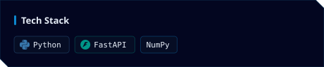
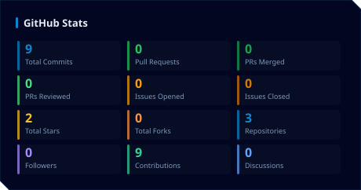
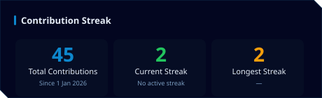
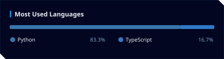
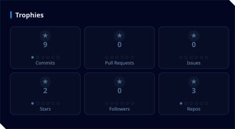

<h1 align="center">Hi there, I'm Le Gia Khanh 👋</h1>

<b>🤖 AI Engineer | Python • FastAPI • NumPy</b>

  
  &nbsp;&nbsp;
  

---

### 🛸 Profile HUD

  <picture>
    <source media="(prefers-color-scheme: light)" srcset="assets/profile-light.svg?v=2">
    
  </picture>

---

### 🛠️ Tech Stack

  <picture>
    <source media="(prefers-color-scheme: light)" srcset="assets/stack-light.svg">
    
  </picture>

---

### 📊 GitHub Stats & Streak

  <picture>
    <source media="(prefers-color-scheme: light)" srcset="assets/stats-light.svg">
    
  </picture>

 

  <picture>
    <source media="(prefers-color-scheme: light)" srcset="assets/streak-light.svg">
    
  </picture>

---

### 📈 Most Used Languages

  <picture>
    <source media="(prefers-color-scheme: light)" srcset="assets/langs-light.svg">
    
  </picture>

---

### 🏆 Achievement Trophies

  <picture>
    <source media="(prefers-color-scheme: light)" srcset="assets/trophies-light.svg">
    
  </picture>

---

### 📅 Contribution Calendar

  

---

### 🌟 Featured Project

- 🤖 **[Enterprise Customer Support AI Platform](https://github.com/khanh1912005/enterprise-customer-support-ai-agent):**  
  Full-stack AI customer support platform built with **FastAPI** and **Python** for automated intelligent workflows and high-concurrency real-time requests.

---

  <i>"Always curious. Always building."</i>

